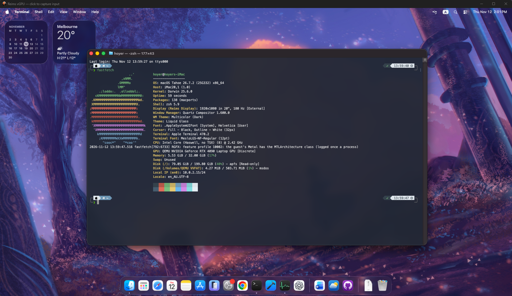

# weims-vgpu

> 最新正式版：**1.1.1** — ゲスト内のソフトウェアが QEMU の制御チャネルに到達できた問題を解消し、シャットダウンを修正しました。Manager の Shut down が機能し、macOS の終了後に QEMU が終了します。[ダウンロード](https://github.com/H0yeR404/weims-vgpu/releases/tag/v1.1.1)
>
> プレビュー版：**1.2.0-pre.1** — Guest Tools が Windows と macOS の間でクリップボードのテキストを共有し、新しいランタイムでは VM を閉じると QEMU がすぐに終了します。[ダウンロード](https://github.com/H0yeR404/weims-vgpu/releases/tag/v1.2.0-pre.1)

[English](README.md) · [简体中文](README.zh-CN.md) · [日本語](README.ja.md)



## クイックスタート — Windows · 1.1.1

> **既知の問題：解像度変更時などに VM がフリーズする可能性があります。既知の問題として今後の更新で修正予定です。重要なデータをバックアップしてください。** 管理アプリは開発中です。自動準備から Tahoe 復旧画面までを本機で確認しましたが、新規インストールからデスクトップまでの全工程は未検証です。

必要環境：Windows 10 2004+/11 x64、BIOS/UEFI の仮想化、**Windows ハイパーバイザー プラットフォーム（WHPX）**、`VK_EXT_external_memory_host` 対応の Vulkan GPU とドライバー。「Windows の機能の有効化または無効化」で WHPX を有効にして再起動してください。アプリは BIOS や Windows 機能を自動変更しません。配布版には **WSL2、MSYS2、Rust、.NET SDK は不要**です。GitHub、Apple、上流のダウンロードサーバーへの接続が必要です。

### インストールと VM 作成

1. [正式リリース](https://github.com/H0yeR404/weims-vgpu/releases/tag/v1.1.1)から `Weims-Manager-1.1.1-Setup-x64.exe` またはポータブル ZIP を取得します。インストーラーとアプリには Weims アイコンが含まれます。正式版の Weims Manager フォルダーにインストールします。既定は英語とライトテーマで、サイドバーから言語と外観を即時に切り替えられます。
2. **Weims Manager → Create VM** で新しい保存先、名前、容量（既定 **200 GiB**）を選びます。Apple からの Tahoe 復旧イメージ自動取得を有効のままにするか、互換性のある `BaseSystem.dmg` / `.img` を選択します。完全な ISO と ARM macOS には対応しません。
3. **Create** を押すと PowerShell、QEMU/Reims、検証付き Apple 復旧イメージの取得、固有のマシン識別情報を持つ OpenCore、OVMF、対応グラフィックスドライバーと ROM の準備、イメージ変換、空ディスク作成を行います。WSL 操作、EFI 編集、ファームウェアのコピー、SMC キー入力は不要です。既存の保存先は上書きしません。スパースディスクの容量は実空き容量の予約ではありません。
4. 起動し、OpenCore で復旧項目を選びます（非表示の場合は **Space**）。**ディスクユーティリティ → すべてのデバイスを表示**で容量を確認し、**新規の空システムディスクだけ**を **GUID パーティションマップ / APFS** で消去します。復旧ディスクや OpenCore ディスクを消去しないでください。
5. ディスクユーティリティを閉じ、**macOS Tahoe を再インストール**で新しいボリュームを選びます。ダウンロードと再起動を待ち、進行に応じてインストーラー／システムを選択します。デスクトップに到達したら正常終了し（VM ウィンドウは自動的に閉じます）、復旧イメージの接続を解除し、保存後に再起動します。

新規 VM は**ウィンドウサイズに合わせたゲスト解像度変更**と自由なポインター移動が既定です。ログイン後に独立した Reims ウィンドウをドラッグします。既存 VM は停止後、**Display & Input → Auto fit guest resolution** を選択し、枠なし表示を無効にして保存します。起動解像度は **800–4096 × 600–2160**、**2560×1440 は本機のみで検証済み**です。Fixed は全画面を拡縮し、Compatibility は従来の動作を維持します。応答しなくなった場合はログを保存し、可能なら正常終了してください。クリップボード共有は 1.2.0-pre.1 プレビュー版の Guest Tools で利用できます。ファイル共有は含まれません。

### コマンドライン（インストーラー・ポータブル版に同梱）

アプリのディレクトリで Windows PowerShell を開きます。`create` は同じ構成を自動準備します。`--recovery` を省略すると Apple から取得します。

```powershell
.\Weims.Cli.exe create --destination D:\VMs\macOS-Tahoe --disk-gib 200
.\Weims.Cli.exe start --config D:\VMs\macOS-Tahoe\state\config.json --display-mode auto
.\Weims.Cli.exe status --config D:\VMs\macOS-Tahoe\state\config.json
.\Weims.Cli.exe shutdown --config D:\VMs\macOS-Tahoe\state\config.json
```

既存 200 GiB VM は実際の `state/config.json` を `start` に渡します。ディスクを作り直さないでください。実行環境がない場合は先に `setup` を実行します。GUI と CLI は同じ設定を使用します。更新時に保持したカスタムフォルダーを優先し、それがなければ既存の `%LOCALAPPDATA%\Weims\Manager-Preview` を再利用します。新規インストールは `%LOCALAPPDATA%\Weims\Manager` を使用します。`--data-dir` で別の設定フォルダーを指定できます。同じディスクを二重起動しないでください。`shutdown` は macOS にすべてのアプリを終了してシステムを終了するよう要求します。未保存の書類がある場合は macOS が先に確認し、ゲストの電源が切れると QEMU は終了します。`stop` は 1.1.0 以前で起動し、終了後も QEMU が残った VM にのみ必要です。

[1.1.1 リリースノート](https://github.com/H0yeR404/weims-vgpu/blob/v1.1.1/docs/release-1.1.1.ja.md)。グラフィックスランタイムは v1.1.0-pre.1 のままです。今回の更新は VM フリーズの修正を意味しません。

## 外観、言語、ソフトウェア更新

サイドバーの **Appearance → Light / Dark** で現在のウィンドウと開いているセットアップ画面がすぐに切り替わります。選択は保存され、再起動や未保存設定の破棄は不要です。Windows のハイコントラスト設定が優先されます。既定の言語は英語で、英語と中国語も即時に切り替えられます。

**Software updates → Check for updates** でリリースノートを確認し、**Update now** を選択します。公式インストーラーを取得して SHA256 を検証します。インストール前にすべての QEMU VM とほかの Manager を閉じてください。アプリの更新時のみ Manager を再起動します。正式版は新しい正式版のみを受け取ります。1.1.0 と pre.2 は既存の更新機能から 1.1.1 に更新できます。1.0.1 と pre.1 は手動インストールが必要です。

更新後も選択した設定ディレクトリを GUI と CLI で使用します。ポータブル版の更新はユーザー用アプリフォルダーへのインストールになります。ランタイムと VM ディスクは置き換えません。旧 Preview アプリは自動削除されないため、更新後は正式版 Weims Manager のショートカットを使用してください。

## ワンクリック実行環境セットアップ

初回起動時は実行環境のページを表示します。**One-click setup** で取得、検証、パスの保存を行い、有効な既存環境は再利用します。Manager が導入した実行環境がこのバージョンに付属するものより古い場合は実行環境のページに表示され、**One-click setup** で新しいものに切り替わります。自分で指定した実行環境は置き換えません。手動パスは **Advanced** にあります。インポートした VM の起動時も不足コンポーネントを準備します。BIOS の仮想化、Windows 機能、GPU ドライバーは手動対応が必要な場合があります。

## Guest Tools：クリップボード共有 — プレビュー版 1.2.0-pre.1

VM のウィンドウが前面にある間、Guest Tools が Windows と macOS の間でクリップボードのテキストを共有します。

1. VM を起動して macOS にログインします。
2. Manager で **Enable Guest Tools integration for this VM** をオンにし、**Install Guest Tools…** をクリックします。macOS にインストールディスクが現れます。
3. macOS でディスクを開き、**Install Weims Guest Tools** をダブルクリックします。現在のユーザーにインストールされ、この VM とペアリングし、ディスクを取り出します。入力は不要です。

片方でコピーし、もう片方で貼り付けます。テキストは 4 MiB までで、パスワードマネージャーが機密と示した内容は相手側のクリップボード履歴に残りません。新しい Manager を入れると macOS 側の Guest Tools は自動で更新されます。削除するには、インストールディスクの **Uninstall Weims Guest Tools.command** を実行します。CLI にも同じ機能があります：`tools-enable`、`tools-install`、`tools-status`。

### 方法 B：ソースからビルド（上級者向け）

Weims の変更、Windows グラフィックスバックエンドのビルド、ソースからの再現に使用します。

**手順 1 — 必要なツールをインストール**

- [Git for Windows](https://git-scm.com/downloads/win)
- [PowerShell 7](https://github.com/PowerShell/PowerShell/releases)
- [Rustup](https://rustup.rs/)
- [MSYS2](https://www.msys2.org/)

MSYS2 は `C:\msys64` にインストールするか、以下のパスを実際の場所に変更してください。

**手順 2 — MSYS2 を設定**

ここで使うのは **Windows の MSYS2 UCRT64 であり、WSL2 ではありません**。MSYS2 は `pacman` を使用しますが、`mingw-w64-ucrt-x86_64-*` は Windows ビルド用パッケージで、Arch Linux のパッケージではありません。Debian/Ubuntu の `apt`、Arch の `pacman`、Fedora の `dnf` で、この Windows ネイティブビルド環境を置き換えることはできません。

**Windows のスタートメニュー → MSYS2 UCRT64** を開くか、**Windows PowerShell** から起動します。

```powershell
& 'C:\msys64\msys2_shell.cmd' -defterm -here -no-start -ucrt64
```

開いた端末で `echo "$MSYSTEM"` を実行し、`UCRT64` と表示されることを確認します。違う場合は正しい端末を開き直してください。以下は **UCRT64 端末内**で実行し、PowerShell、コマンドプロンプト、Git Bash、WSL の端末には直接貼り付けないでください。

```sh
pacman -Syu
```

端末の再起動を求められた場合は、再起動して更新を再実行します。その後、ビルドツールをインストールします。

```sh
pacman -S --needed git make diffutils bison flex mtools \
  mingw-w64-ucrt-x86_64-{clang,llvm,llvm-tools,lld,cmake,meson,ninja,python,glib2,pixman,pkgconf,libslirp,libusb,SDL2,vulkan-headers,vulkan-loader,vulkan-validation-layers,spirv-tools}
```

**手順 3 — Weims を取得してビルド**

**Windows の PowerShell 7** に戻って実行します。`scripts/build.ps1` は必要に応じて MSYS2 を呼び出し、Windows 実行ファイルを生成します。Linux 用のビルドスクリプトではありません。

```powershell
git clone https://github.com/H0yeR404/weims-vgpu.git
cd weims-vgpu

$env:WEIMS_MSYS2 = "C:\msys64"

rustup toolchain install nightly-2026-11-03-x86_64-pc-windows-gnu --profile minimal

pwsh -File scripts/fetch.ps1
pwsh -File scripts/build.ps1
```

スクリプトは固定した Reims、QEMU、metal2vulkan のソースを取得し、Windows 互換パッチを検証・適用して、Windows ネイティブの QEMU/Reims をビルドします。

出力先：

```text
build/port-qemu/
build/port-dist/
```

対応するグラフィックス ROM：

```text
sources/reims/firmware/prebuilt/ReimsGraphics.rom
```


Manager/CLI のビルドには .NET 10 SDK をインストールし、次を実行します：

```powershell
pwsh -File manager/build-display.ps1
pwsh -File manager/build-setup.ps1
pwsh -File manager/build.ps1 -SelfContained
```

### 任意：WSL2 のツールで EFI ファイルを確認・準備

前述の Windows 手順では、この節は不要です。WSL2 の Linux ツールはファイルの確認や OpenCore raw FAT イメージのコピーの準備に使えますが、以下のパッケージは **Windows QEMU/Reims のビルド環境の代わりにはなりません**。WHPX の有効化や Windows Vulkan ドライバーの導入も行いません。

WSL2 を既に利用している場合は、**Windows PowerShell** で導入済みディストリビューションを一覧表示して、そのうちの 1 つを開きます。`Ubuntu` は一覧の正確な名前（`Debian`、`Arch`、または表示された Fedora の名前など）に変更してください。

```powershell
wsl --list --verbose
wsl -d Ubuntu
```

一覧で対象の WSL バージョンが `2` であることを確認します。Linux の端末内で `cat /etc/os-release` を使ってディストリビューションを確認し、**該当するコマンドだけ**を実行してください。以下は `sudo` 権限のあるユーザーを想定しています。root の場合は `sudo` を省略できます。

**Debian / Ubuntu — WSL2 内で実行：**

```sh
sudo apt update
sudo apt install git python3 mtools
```

**Arch Linux — WSL2 内で実行：**

```sh
sudo pacman -Syu --needed git python mtools
```

**Fedora — WSL2 内で実行：**

```sh
sudo dnf install git python3 mtools
```

EFI 補助スクリプトは `tomllib` を使うため **Python 3.11 以降**が必要です。`python3 --version` と `python3 -c 'import tomllib'` で確認してください。利用できない場合は Python 3.11 以降を提供するディストリビューションのバージョンか、前述の MSYS2 手順を使用します。

パスも端末によって異なります。Windows の `C:\VM-inputs\OpenCore.img` は MSYS2 では `/c/VM-inputs/OpenCore.img`、WSL2 では `/mnt/c/VM-inputs/OpenCore.img` です。WSL2 では実際のリポジトリの場所（例：`cd /mnt/d/Coding/weims-vgpu`）に移動し、EFI 補助コマンドを `/ucrt64/bin/python.exe ...` ではなく `python3 scripts/prepare-opencore.py vm/boot-work/EFI` に変更します。これはソース取得済みの状態で、コピーしたイメージの EFI 準備だけを置き換える方法です。同じコピーに両方の準備手順を実行しないでください。Windows の `ocvalidate`、ビルド、VM 起動は Windows PowerShell に戻って実行します。`exit` で WSL2 を終了できます。

## 検証環境

> **互換性について：** 本プロジェクトは現在、以下の実機構成でのみテストし、正常動作を確認しています。他の機器も理論上は対応可能ですが、互換性と正常動作の確認には実機での検証が必要です。

| 項目 | 構成 |
| --- | --- |
| ノート PC | Lenovo Legion Y9000P IRX8H（82WQ） |
| ホスト OS | Windows 11 Pro for Workstations、x86_64 |
| Windows ビルド | 10.0.26300.9550（Fastfetch の表示は 26H2） |
| CPU | Intel Core i9-13900HX、32 論理プロセッサー |
| GPU | NVIDIA GeForce RTX 4090 Laptop GPU、報告 VRAM 15.67 GiB |
| ホストメモリ | 報告された使用可能な総容量 95.81 GiB |
| ホスト画面 | CU34G4 外部モニター、3440 × 1440、180 Hz |
| ホストシェル | PowerShell 7.6.9 |
| 仮想化 / グラフィックス | WHPX / Vulkan、ゲストメモリ共有経路 |
| 検証用ゲスト | macOS Tahoe、8 vCPU、32 GiB メモリ、200 GiB 仮想システムディスク |
| ゲスト解像度 | 1920 × 1080 |

これは検証済みの機器構成であり、最低要件や推奨構成ではありません。ホスト画面のリフレッシュレートはゲストの描画 FPS とは異なります。また、ホストの既存 PowerShell と、自動セットアップが必要に応じて取得する固定版 PowerShell 7.7.0 は別です。

実装は C API テスト 22 件に合格しました。10 秒間のウィンドウ移動テストでは、異なる画面の更新頻度が 54.17 FPS、最大フレーム間隔が 211 ms でした。これは同一条件での旧経路との比較や長期安定性の保証ではありません。ホストの device cache と必要なコピーが残るため、完全なゼロコピーではありません。

## 上流プロジェクトとライセンス

[Reims vGPU](https://github.com/steelbrain/reims-vgpu)、[metal2vulkan](https://github.com/steelbrain/metal2vulkan)、[QEMU Reims](https://github.com/steelbrain/qemu-reims-vgpu)、および [tqmane の Windows 移植](https://github.com/tqmane/reims-vgpu) に基づいています。公式の上流リリースではありません。

Reims と metal2vulkan は `GPL-2.0-or-later OR LGPL-3.0-or-later`、QEMU は元のファイルごとのライセンスを維持します。統合スクリプトと文書は GPL-2.0-or-later です。[LICENSE](LICENSE)、[帰属と来歴](NOTICE.md)、[ライセンス全文](licenses/) を参照してください。スクリーンショット内の Apple ソフトウェア、商標、第三者コンテンツの権利は、このリポジトリから許諾されるものではありません。
