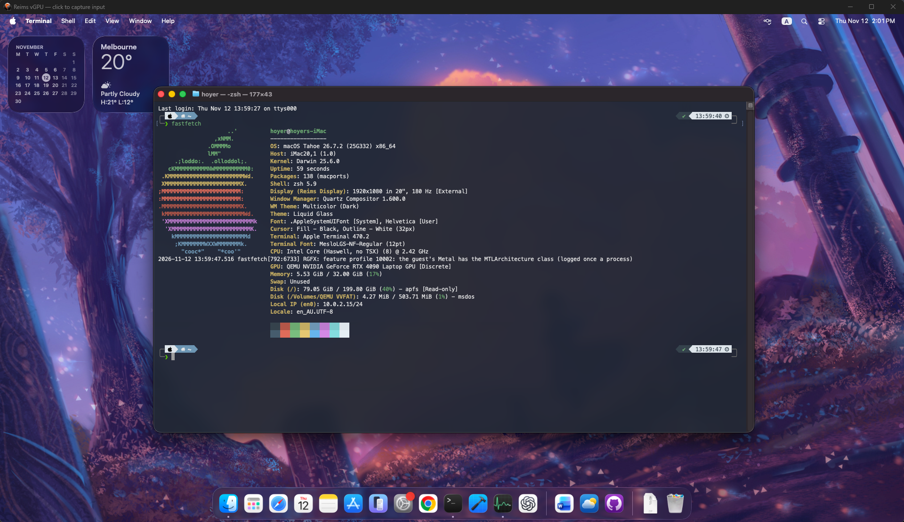

# weims-vgpu

[Weims Manager 1.0 をダウンロード](https://github.com/H0yeR404/weims-vgpu/releases/tag/v1.0)：Windows インストーラー、英語（既定）・中国語 UI、実行環境の自動セットアップ。

Windows 向け [Weims Manager 1.0](manager/README.md) を追加しました。復元イメージの準備と仮想マシン設定を GUI で行い、VM の表示ウィンドウは独立して動作します。UI は英語（既定）と中国語に対応しています。

[English](README.md) · [简体中文](README.zh-CN.md) · [日本語](README.ja.md)

Windows 上で WHPX と Vulkan を使い、Reims の新しいグラフィックス経路を動かすための統合プロジェクトです。新しいゲストドライバーとプロトコルを維持しながら、Windows の section によってゲスト RAM を共有し、従来の Windows 移植で発生していた深刻な書き戻し遅延に対処します。



所有者提供のスクリーンショットには、macOS Tahoe、8 vCPU、32 GiB のメモリ、約 200 GiB の APFS ボリュームが表示されています。180 Hz という表示モードは、180 FPS の実測結果を意味しません。

## ビルドと起動

[再現手順](docs/reproduce.md) に、ツールの導入、固定したソースの取得、パッチ適用、ビルド、ゲストドライバーの組み込み、起動方法を記載しています。このリポジトリはソースパッチとスクリプトを配布します。リリースには対応ソース付きのホスト実行環境を提供しますが、macOS ディスクは含みません。起動可能な macOS VM と OpenCore、OVMF は各自で用意してください。

```powershell
git clone https://github.com/H0yeR404/weims-vgpu
cd weims-vgpu
$env:WEIMS_MSYS2 = 'C:\msys64'
# 先に docs/reproduce.md のツールをインストールしてください。
pwsh -File scripts/fetch.ps1
pwsh -File scripts/build.ps1
```

ビルド後、元の VM を停止してシステムディスクを複製します。OpenCore のコピーに Graft、ReimsGraphics、RgfxGate を組み込み、`scripts/init-vm.ps1` で設定を生成し、`scripts/start.ps1` で起動します。引数は再現手順を参照してください。既定の QMP 4444 と SSH 2222 は localhost のみにバインドします。他の VM とのポート競合を避けてください。複製したディスク間で変更は同期されません。

## 検証環境

> **互換性について：** 本プロジェクトは現在、以下の実機構成でのみテストし、正常動作を確認しています。他の機器も理論上は対応可能ですが、互換性と正常動作の確認には実機での検証が必要です。

| 項目 | 構成 |
| --- | --- |
| ノート PC | Lenovo Legion Y9000P IRX8H（82WQ） |
| ホスト OS | Windows 11 Pro for Workstations、x86_64 |
| Windows ビルド | 10.0.26300.9550（Fastfetch の表示は 26H2） |
| CPU | Intel Core i9-13900HX、32 論理プロセッサー |
| GPU | NVIDIA GeForce RTX 4090 Laptop GPU、報告 VRAM 15.67 GiB |
| ホストメモリ | 報告された使用可能な総容量 95.81 GiB |
| ホスト画面 | CU34G4 外部モニター、3440 × 1440、180 Hz |
| ホストシェル | PowerShell 7.6.9 |
| 仮想化 / グラフィックス | WHPX / Vulkan、ゲストメモリ共有経路 |
| 検証用ゲスト | macOS Tahoe、8 vCPU、32 GiB メモリ、200 GiB 仮想システムディスク |
| ゲスト解像度 | 1920 × 1080 |

これは検証済みの機器構成であり、最低要件や推奨構成ではありません。ホスト画面のリフレッシュレートはゲストの描画 FPS とは異なります。また、ホストの既存 PowerShell と、自動セットアップが必要に応じて取得する固定版 PowerShell 7.7.0 は別です。

実装は C API テスト 22 件に合格しました。10 秒間のウィンドウ移動テストでは、異なる画面の更新頻度が 54.17 FPS、最大フレーム間隔が 211 ms でした。これは同一条件での旧経路との比較や長期安定性の保証ではありません。ホストの device cache と必要なコピーが残るため、完全なゼロコピーではありません。

## 上流プロジェクトとライセンス

[Reims vGPU](https://github.com/steelbrain/reims-vgpu)、[metal2vulkan](https://github.com/steelbrain/metal2vulkan)、[QEMU Reims](https://github.com/steelbrain/qemu-reims-vgpu)、および [tqmane の Windows 移植](https://github.com/tqmane/reims-vgpu) に基づいています。公式の上流リリースではありません。変更には AI 支援を使用しています。

Reims と metal2vulkan は `GPL-2.0-or-later OR LGPL-3.0-or-later`、QEMU は元のファイルごとのライセンスを維持します。統合スクリプトと文書は GPL-2.0-or-later です。[LICENSE](LICENSE)、[帰属と来歴](NOTICE.md)、[ライセンス全文](licenses/) を参照してください。スクリーンショット内の Apple ソフトウェア、商標、第三者コンテンツの権利は、このリポジトリから許諾されるものではありません。
