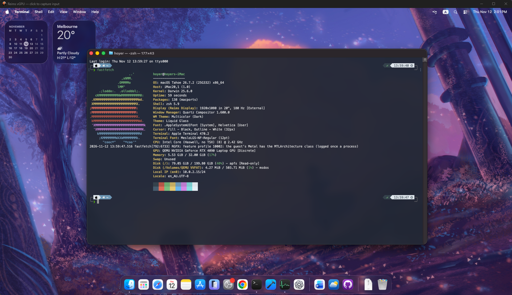

# weims-vgpu

[Download Weims Manager 1.0.1](https://github.com/H0yeR404/weims-vgpu/releases/tag/v1.0.1) — Windows installer, English by default, optional Chinese, and automatic runtime setup.

The Windows [Weims Manager 1.0.1](manager/README.md) adds a graphical configuration utility with recovery-image preparation and independent VM windows.

[English](README.md) · [简体中文](README.zh-CN.md) · [日本語](README.ja.md)

Run the Reims graphics lane on Windows with WHPX and Vulkan. This independent integration preserves the new guest graphics protocol while sharing Windows guest-RAM sections with the host renderer, addressing the severe copy-path slowdown observed in the earlier Windows port.



The owner-supplied screenshot shows macOS Tahoe, 8 vCPUs, 32 GiB RAM and a roughly 200 GiB APFS volume. Its reported 180 Hz display mode does not represent measured rendering performance.

## Build and run

Follow the [complete reproduction guide](docs/reproduce.md) for tools, fixed source revisions, patch application, build commands, guest-driver injection and VM startup. This repository distributes source patches and scripts, and versioned host runtime releases, but not macOS disks. Supply your own working macOS VM, OpenCore and OVMF files.

```powershell
git clone https://github.com/H0yeR404/weims-vgpu
cd weims-vgpu
$env:WEIMS_MSYS2 = 'C:\msys64'
# Install the prerequisites in docs/reproduce.md first.
pwsh -File scripts/fetch.ps1
pwsh -File scripts/build.ps1
```

## Tested environment

> **Compatibility note:** This project has only been tested and confirmed working on the machine listed below. Other devices are theoretically supported, but compatibility and successful operation require actual testing.

| Component | Configuration |
| --- | --- |
| Laptop | Lenovo Legion Y9000P IRX8H (82WQ) |
| Host OS | Windows 11 Pro for Workstations, x86_64 |
| Windows build | 10.0.26300.9550 (reported as 26H2 by Fastfetch) |
| CPU | Intel Core i9-13900HX, 32 logical processors |
| GPU | NVIDIA GeForce RTX 4090 Laptop GPU, 15.67 GiB reported VRAM |
| Host RAM | 95.81 GiB reported usable memory |
| Host display | CU34G4 external monitor, 3440 × 1440 at 180 Hz |
| Host shell | PowerShell 7.6.9 |
| Virtualization / graphics | WHPX / Vulkan, shared guest-memory graphics path |
| Tested guest | macOS Tahoe, 8 vCPUs, 32 GiB RAM, 200 GiB virtual system disk |
| Guest resolution | 1920 × 1080 |

This is the tested machine, not a minimum or recommended specification. Host display refresh rate is separate from guest rendering FPS. The host's existing PowerShell version is also separate from the pinned PowerShell 7.7.0 package used by automatic setup when needed.

The implementation passed 22 C API tests. One 10-second drag test measured 54.17 unique FPS, with a maximum 211 ms frame gap. These are limited measurements, not universal performance or stability guarantees. Shared guest memory still involves host device caches and is not full zero-copy.

## Upstream and licensing

Built on [Reims vGPU](https://github.com/steelbrain/reims-vgpu), [metal2vulkan](https://github.com/steelbrain/metal2vulkan), [QEMU Reims](https://github.com/steelbrain/qemu-reims-vgpu) and Windows work from [tqmane](https://github.com/tqmane/reims-vgpu). This project is not an official upstream release. Modifications were prepared with AI assistance.

Reims and metal2vulkan retain `GPL-2.0-or-later OR LGPL-3.0-or-later`; QEMU retains its original per-file licenses. Integration scripts and documentation use GPL-2.0-or-later. Read [LICENSE](LICENSE), [attribution and provenance](NOTICE.md), and the [license texts](licenses/). Apple software and third-party content shown in the screenshot are not licensed by this repository.
