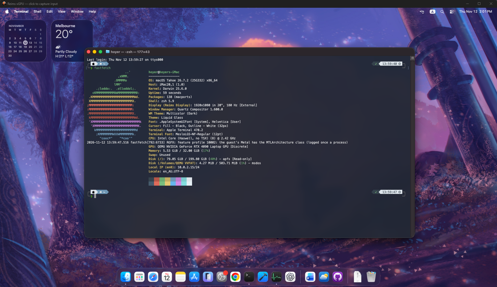

# weims-vgpu

> Latest release: **1.2.0** — Guest Tools shares the clipboard between Windows and macOS, copies and pastes files, and mounts shared folders; the runtime is now built directly from upstream: macOS has sound, its resolution follows the window, and QEMU exits at once when a VM closes. [Download](https://github.com/H0yeR404/weims-vgpu/releases/tag/v1.2.0)

[English](README.md) · [简体中文](README.zh-CN.md) · [日本語](README.ja.md)



## Quick Start — Windows · 1.2.0

> **Known issue: the VM may freeze. This is a known issue and will be addressed in a future update. Back up important data.** The manager is still under development. Automatic preparation has reached the Tahoe recovery menu on the test host; a complete fresh installation to the desktop has not been validated.

Requirements: Windows 10 2004+/11 x64, BIOS/UEFI virtualization, **Windows Hypervisor Platform (WHPX)** enabled (restart Windows after enabling it), and a GPU and driver supporting Vulkan 1.3. Enable WHPX in **Turn Windows features on or off**. The app does not enable firmware virtualization or Windows features for you. WSL2, MSYS2, Rust and the .NET SDK are **not needed for the packaged app**. Internet access to GitHub, Apple and upstream download servers is required.

### Install and create a VM

1. Download `Weims-Manager-1.2.0-Setup-x64.exe` from the [release](https://github.com/H0yeR404/weims-vgpu/releases/tag/v1.2.0), or extract the portable ZIP. The installer and app use the Weims icon. The installer uses the stable Weims Manager application folder. English and light appearance are the defaults; language and appearance can be changed immediately in the sidebar.
2. Open **Weims Manager → Create VM**. Choose a new VM location, name and disk capacity (default **200 GiB**). Keep automatic Apple Tahoe recovery download enabled, or select your own compatible `BaseSystem.dmg` / `.img`. Full ISO and ARM macOS are not supported.
3. Click **Create**. The app prepares PowerShell and QEMU/Reims, downloads and verifies Apple recovery, generates OpenCore with a new machine identity, prepares OVMF and matching graphics drivers/ROM, converts recovery media, and creates the empty disk. No manual WSL, EFI editing, firmware copying or SMC-key entry is needed. Existing destinations are rejected. Sparse capacity does not reserve physical disk space.
4. Start the VM. In OpenCore select recovery (press **Space** if hidden). In **Disk Utility → View → Show All Devices**, erase **only the new empty system disk**, identified by its capacity, as **GUID Partition Map / APFS**. Never erase the recovery or OpenCore disks.
5. Close Disk Utility, choose **Reinstall macOS Tahoe**, and select the new volume. Allow downloads and restarts; choose the installer/system entry as installation progresses. After reaching the desktop, shut down macOS (the VM window closes by itself), detach recovery in the Manager, save and boot again.

macOS's resolution follows the VM's window: drag an edge and the image fills the new size. The window opens at the startup resolution set under **Display & Input** (**800–4096 × 600–2160**). New VMs have the free pointer on: the pointer moves in and out of the window, and Windows keeps its own shortcuts. With it off, a click in the window captures keyboard and pointer and **Ctrl+Alt+Win** releases them; games that need relative mouse motion use that mode. macOS has sound output. The clipboard, copying and pasting files, and shared folders need Guest Tools, described below.

### Command line (included with installer and portable ZIP)

Run in Windows PowerShell from the application's installation/extraction directory. `create` prepares the same components automatically; omit `--recovery` to download from Apple.

```powershell
.\Weims.Cli.exe create --destination D:\VMs\macOS-Tahoe --disk-gib 200
.\Weims.Cli.exe start --config D:\VMs\macOS-Tahoe\state\config.json
.\Weims.Cli.exe status --config D:\VMs\macOS-Tahoe\state\config.json
.\Weims.Cli.exe shutdown --config D:\VMs\macOS-Tahoe\state\config.json
```

For an existing VM, use its actual `state/config.json` with `start`; do not recreate its disk. A VM made with an earlier version gets its boot image made again at its first start, with this runtime's graphics drivers and the same Mac identity; the previous image stays beside it as `OpenCore.img.previous`. Run `setup` first if this profile has no runtime. GUI and CLI use the same profile: an updater-retained custom profile takes precedence; otherwise an existing `%LOCALAPPDATA%\Weims\Manager-Preview` is reused, or `%LOCALAPPDATA%\Weims\Manager` is used for fresh stable installs. Use `--data-dir` to choose another profile. Please do not launch the same disk twice. `shutdown` asks macOS to quit all apps and shut down; macOS asks about unsaved documents first, and QEMU exits when the guest has powered off. `stop` is only needed for a VM started by 1.1.0 or older whose QEMU stayed behind after shutdown.

[1.2.0 release notes](https://github.com/H0yeR404/weims-vgpu/blob/v1.2.0/docs/release-1.2.0.md). This version comes with runtime 1.2.0. After upgrading from an earlier version the runtime must be updated: click **Update runtime now** at the top of Manager. VMs cannot start before that.

## Appearance, language and updates

Choose **Appearance → Light / Dark** in the sidebar. The current window and open setup windows change immediately; the choice is saved without restarting or discarding unsaved configuration. Windows high contrast takes precedence. English remains the default language, and English/Chinese also switch immediately.

In **Software updates → Check for updates**, read the release notes and select **Update now**. The official installer is downloaded and SHA256-verified. Close all QEMU VMs and other Manager windows before installation; only the software update restarts Manager. 1.1.0 and 1.1.1 users can update to 1.2.0 through their existing updater, and the 1.2.0-pre.1 preview is offered it too. Users of 1.0.1 need to download the installer manually once.

The **Update channel** decides what a check offers: **Stable releases** offers stable releases only, **Preview and stable releases** offers both. Until you choose, a stable Manager is on the stable channel and a preview Manager on the preview channel. A preview installs as Weims Manager Preview beside the stable app and uses the same settings. Going back from the preview channel to the stable one does not downgrade: the installed preview stays until a stable release newer than it exists.

The updater preserves the chosen settings directory for subsequent GUI and CLI launches. Updating a portable copy installs into the per-user application folder. The runtime and VM disks are not replaced. The retained Preview application is not automatically uninstalled; after upgrading, use the stable Weims Manager shortcut.

## One-click runtime setup

First-time users open the runtime page automatically. **One-click setup** downloads, verifies and saves runtime paths; a valid existing runtime is reused. If the runtime that Manager installed is older than the one this version comes with, a notice appears at the top of Manager and **Update runtime now** switches to the newer one. 1.2.0 requires its runtime: VMs cannot start before the update. A runtime you chose yourself is left alone. Manual paths remain available under **Advanced**. Starting an imported VM prepares missing components automatically. Firmware virtualization, Windows features and GPU drivers may still require manual action.

## Guest Tools: clipboard, files and shared folders

Guest Tools shares the clipboard between Windows and macOS while the VM's window is in front, text and files, and mounts folders of this PC in macOS.

1. Start the VM and log in to macOS.
2. In Manager, turn on **Enable Guest Tools integration for this VM** and click **Install Guest Tools…**. An install disk appears in macOS.
3. In macOS, open the disk and double-click **Install Weims Guest Tools**. It installs for the current user, pairs with this VM and ejects the disk. Nothing is typed.

Copy on one side, paste on the other. Text up to 4 MiB is carried, and what a password manager marks as sensitive stays out of the clipboard history on the other side. A newer Manager updates Guest Tools in macOS by itself. To remove it, run **Uninstall Weims Guest Tools.command** from the install disk. The CLI has the same functions: `tools-enable`, `tools-install`, `tools-status`.

### Copying and pasting files

Copy files or folders in Explorer, click into the VM's window and paste in Finder. Or copy in Finder, switch to Windows and paste in Explorer. **Copy and paste files between Windows and macOS** under Guest Tools switches this on and off; it is on unless you switch it off, and works while the clipboard is shared.

- **Windows to macOS.** Nothing is sent when you copy. macOS reads the files from this PC when you paste, so there is no limit on size and Finder shows its usual progress. macOS can read what you copied and what is in a copied folder, and nothing beside it. The last three copies stay readable. Files on a network location are left out, and so is what exceeds eight different folders in one copy; Manager says how many items were left out.
- **macOS to Windows.** Explorer pastes only files that are on this PC, so they are fetched when you leave the VM's window, up to 256 MiB for one copy. Manager shows how far the fetch is under the Guest Tools status; paste when it is done. For more than 256 MiB use a shared folder. Symbolic links are left out, and a character that Windows does not allow in a name becomes an underscore. The fetched files stay in the VM's `state\transfers` folder until the next ones arrive or the VM stops.

Files that are cut in Explorer are treated as copied. Dragging files into or out of the VM's window is not supported.

### Shared folders

Under **Guest Tools → Shared folders**, click **Share a folder…** and choose a folder on this PC. While the VM runs, Guest Tools mounts it in macOS under `/Volumes` and puts a link to it into the folder **Weims Shared Folders** in your macOS home folder; the Guest Tools menu in the menu bar opens it too. A folder is there about a second after it is shared. Finder's sidebar does not list the folders: it would show their server's address, which leads to no folders. Tick **Read-only** to keep macOS from changing a folder. The list can be changed while the VM runs; the folders disconnect for a moment and come back.

The folders are for exchanging documents, installers and source files. They are not a macOS disk: symbolic links are not supported, and apps or Xcode projects should not be kept there. Finder leaves `.DS_Store` files in folders it has shown. A link inside a shared folder that leads out of it is closed to macOS. The first time an app in macOS opens a shared folder, macOS asks whether it may access files on a network volume.

Nothing in Windows is changed for this: no Windows share is created, no administrator rights are needed and the firewall is not touched. Manager's own component serves the folders on this PC's loopback address, under a name and password it makes up anew each time.

**Upload limit** is the most that macOS may send to this PC per second, into shared folders and when copied files are fetched. It is 0, no limit, unless you set one; set one if the VM's picture stutters while macOS writes large files. From the command line: `tools-share --folder D:\Work [--name Work] [--access read]`, `tools-unshare --name Work`, `tools-upload-limit --mib 12`.

## Build from source

The source tree builds its runtime from upstream [Reims vGPU](https://github.com/steelbrain/reims-vgpu), which supports Windows hosts itself, with one patch for the window. Release 1.2.0 ships the runtime built this way.

What it changes for a VM, compared with 1.1.1:

- macOS's resolution follows the window: resize the window and the image fills it. The fixed and compatibility display modes are gone.
- The guest has sound output.
- Captured input is released with Ctrl+Alt+Win.
- A VM made with an earlier version gets its OpenCore image made again at its first start, with the new runtime's drivers and the same Mac identity. The previous image stays beside it as `OpenCore.img.previous`.
- The GPU needs Vulkan 1.3.

Install [Git for Windows](https://git-scm.com/downloads/win), [PowerShell 7](https://github.com/PowerShell/PowerShell/releases), [MSYS2](https://www.msys2.org/) in a path without spaces, and the [.NET 10 SDK](https://dotnet.microsoft.com/download). Then, in PowerShell 7:

```powershell
git clone https://github.com/H0yeR404/weims-vgpu.git
cd weims-vgpu
$env:WEIMS_MSYS2 = "C:\msys64"
pwsh -File scripts/fetch.ps1
pwsh -File scripts/build.ps1
pwsh -File manager/build.ps1 -SelfContained
./manager/artifacts/Weims-Manager/Weims.Manager.exe
```

`fetch.ps1` fetches the pinned upstream sources and applies the patch. `build.ps1` runs upstream's own installer in MSYS2's CLANG64 environment, which installs the MSYS2 packages and the Rust toolchain it needs, and assembles `build/weims-runtime`. Manager started from the checkout uses that folder. A first build took about ten minutes on the tested host. [Building from source](docs/reproduce.md) has the details, the tests and release packaging.

## Tested environment

> **Compatibility note:** This project has only been tested and confirmed working on the machine listed below. Other devices are theoretically supported, but compatibility and successful operation require actual testing.

| Component | Configuration |
| --- | --- |
| Laptop | Lenovo Legion Y9000P IRX8H (82WQ) |
| Host OS | Windows 11 Pro for Workstations, x86_64 |
| Windows build | 10.0.26300.9550 |
| CPU | Intel Core i9-13900HX |
| GPU | NVIDIA GeForce RTX 4090 Laptop GPU |
| Host RAM | 95.81 GiB |
| Host display | CU34G4 external monitor, 3440 × 1440 at 180 Hz |
| Host shell | PowerShell 7.6.9 |
| Virtualization / graphics | WHPX / Vulkan, shared guest-memory graphics path |
| Tested guest | macOS Tahoe, 8 vCPUs, 32 GiB RAM, 200 GiB virtual system disk |
| Guest resolution | 1920 × 1080 |

This is the tested machine, not a minimum or recommended specification. Host display refresh rate is separate from guest rendering FPS. The host's existing PowerShell version is also separate from the pinned PowerShell 7.7.0 package used by automatic setup when needed.

This version's runtime was run on this machine on 2026-11-24 and 25 with a macOS 26.7.2 guest: boot, graphics, free pointer, window resizing, sound and shutdown worked, and so did Guest Tools' clipboard, file copy and paste, and shared folders. One window-drag test gave 56 frames per second. This says nothing about long-term stability or other GPUs. The [validation record](docs/validation.md) lists what was tested and what was not.

## Upstream and licensing

This project is built on upstream [Reims vGPU](https://github.com/steelbrain/reims-vgpu). Its goal is to let you try and use a macOS virtual machine on Windows with one click.

Upstream projects used:

- **[Reims vGPU](https://github.com/steelbrain/reims-vgpu)**: the virtual graphics device, its macOS guest drivers and the host window.
- **[metal2vulkan](https://github.com/steelbrain/metal2vulkan)**: translates Apple's Metal API and shaders to Vulkan.
- **[QEMU Reims](https://github.com/steelbrain/qemu-reims-vgpu)**: the QEMU build that carries the device.

Thanks to [steelbrain](https://github.com/steelbrain), the author of all three. This project is not an official upstream release.

Reims and metal2vulkan retain `GPL-2.0-or-later OR LGPL-3.0-or-later`; QEMU retains its original per-file licenses. Integration scripts and documentation use GPL-2.0-or-later. Read [LICENSE](LICENSE), [attribution and provenance](NOTICE.md), and the [license texts](licenses/). Apple software and third-party content shown in the screenshot are not licensed by this repository.
