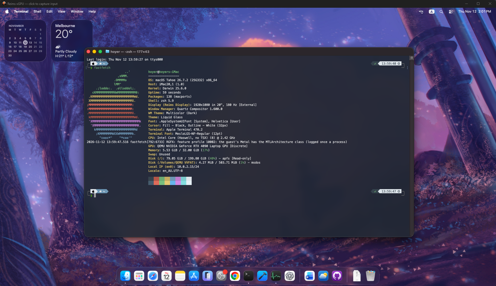

# weims-vgpu

> 最新正式版：**1.1.1** — 堵住虚拟机里的程序连到 QEMU 控制通道的途径，并修复关机：管理器的“正常关机”有效，macOS 关机后 QEMU 自动退出。[下载](https://github.com/H0yeR404/weims-vgpu/releases/tag/v1.1.1)
>
> 预览版：**1.2.0-pre.1** — Guest Tools 在 Windows 和 macOS 之间共享剪贴板文本；新运行组件让 QEMU 在虚拟机关闭后立即退出。[下载](https://github.com/H0yeR404/weims-vgpu/releases/tag/v1.2.0-pre.1)

[English](README.md) · [简体中文](README.zh-CN.md) · [日本語](README.ja.md)



## Windows 快速开始 · 1.1.1

> **已知问题：虚拟机可能卡死，包括调整分辨率时。这是已知问题，将在后续更新中解决。请备份重要数据。** 交互软件仍在开发中。本机已验证自动准备并进入 Tahoe 恢复界面，尚未验证从全新安装到桌面的完整流程。

要求：Windows 10 2004+/11 x64、BIOS/UEFI 开启虚拟化、开启 **Windows 虚拟机监控程序平台（WHPX）** 并重启，以及支持 `VK_EXT_external_memory_host` 的 Vulkan 显卡与驱动。在“启用或关闭 Windows 功能”中启用 WHPX。软件不会自动修改 BIOS 或启用 Windows 功能。使用安装包**无需 WSL2、MSYS2、Rust 或 .NET SDK**。需要访问 GitHub、Apple 和上游下载服务器。

### 安装并创建虚拟机

1. 从[正式发布页面](https://github.com/H0yeR404/weims-vgpu/releases/tag/v1.1.1)下载 `Weims-Manager-1.1.1-Setup-x64.exe`，或解压便携 ZIP。安装包与应用均带有 Weims 图标。安装到正式版 Weims Manager 应用目录。默认英文和浅色，侧栏可即时切换语言与外观。
2. 打开 **Weims Manager → 创建虚拟机**，选择新目录、名称和容量（默认 **200 GiB**）。保留从 Apple 自动下载 Tahoe 恢复镜像，也可选择已有的兼容 `BaseSystem.dmg` / `.img`。不支持完整 ISO 或 ARM macOS。
3. 点击**创建**：自动准备 PowerShell、QEMU/Reims，下载并验证 Apple 恢复镜像，生成具有独立机器身份的 OpenCore，准备 OVMF、配套显卡驱动和 ROM，转换恢复镜像并创建空白磁盘。无需手动操作 WSL、编辑 EFI、复制固件或输入 SMC 密钥。已有目标目录会被拒绝；稀疏磁盘容量不代表已预留实际空间。
4. 启动虚拟机，在 OpenCore 中选择恢复项（隐藏时按**空格**）。进入**磁盘工具 → 显示所有设备**，按容量辨认并仅抹掉**新建的空白系统磁盘**，格式选择 **GUID 分区图 / APFS**。不要抹掉恢复盘或 OpenCore 盘。
5. 退出磁盘工具，选择**重新安装 macOS Tahoe**和新卷，等待下载和多次重启，按安装进度进入安装器或系统。进入桌面后正常关机（虚拟机窗口会自动关闭），在软件中取消挂载恢复镜像，保存后再次启动。

新建虚拟机默认开启**拖拽自适应分辨率**和自由鼠标。登录后拖动独立 Reims 窗口即可。已有虚拟机需先关机，在**显示与输入**选择自动适配客户机分辨率，关闭无边框模式并保存。启动分辨率范围 **800–4096 × 600–2160**；**2560×1440 仅在本机验证通过**。固定模式缩放完整画面，兼容模式保留旧行为。若调整失去响应，请保留日志，并尽可能正常重启。剪贴板共享由 1.2.0-pre.1 预览版的 Guest Tools 提供；不含文件共享。

### 命令行（安装包和便携版均包含）

在应用安装或解压目录打开 Windows PowerShell。`create` 自动准备同样的组件；省略 `--recovery` 即从 Apple 下载。

```powershell
.\Weims.Cli.exe create --destination D:\VMs\macOS-Tahoe --disk-gib 200
.\Weims.Cli.exe start --config D:\VMs\macOS-Tahoe\state\config.json --display-mode auto
.\Weims.Cli.exe status --config D:\VMs\macOS-Tahoe\state\config.json
.\Weims.Cli.exe shutdown --config D:\VMs\macOS-Tahoe\state\config.json
```

已有 200 GiB 虚拟机直接将其实际 `state/config.json` 传给 `start`，不要重新创建磁盘。当前设置尚无运行环境时先执行 `setup`。GUI 与 CLI 共用设置目录：优先使用更新器保留的自定义目录；否则复用已有的 `%LOCALAPPDATA%\Weims\Manager-Preview`，全新正式版使用 `%LOCALAPPDATA%\Weims\Manager`。可通过 `--data-dir` 指定其他目录。不要重复启动同一磁盘。`shutdown` 请求 macOS 退出所有应用并关机，有未保存的文档时 macOS 会先询问；客户机关机后 QEMU 自动退出。`stop` 只用于 1.1.0 及更早版本启动、关机后仍残留的 QEMU。

[1.1.1 发布说明](https://github.com/H0yeR404/weims-vgpu/blob/v1.1.1/docs/release-1.1.1.zh-CN.md)。图形运行库仍固定为 v1.1.0-pre.1；此次管理器更新不代表已修复虚拟机卡死问题。

## 外观、语言与软件更新

在侧栏选择 **外观 → 浅色 / 深色**，当前窗口与已打开的安装向导立即生效，选择会保存，无需重启，也不会丢失未保存的配置。Windows 高对比度设置优先。默认语言仍为英文，中英文也可即时切换。

打开 **软件更新 → 检查更新**，查看更新说明后点击 **一键更新**。软件下载官方安装包并校验 SHA256。安装前需关闭所有 QEMU 虚拟机和其他 Manager 窗口；只有软件升级需要重启管理器。正式版仅接收更新的正式版：1.1.0 和 pre.2 可通过现有更新器升级到 1.1.1。1.0.1 和 pre.1 用户需手动下载安装一次。

更新器会保留所选设置目录，以后 GUI 和 CLI 均继续使用。便携版更新后安装到当前用户应用目录，不替换图形运行库或虚拟机磁盘。旧 Preview 应用不会自动卸载，升级后请使用正式版 Weims Manager 快捷方式。

## 一键准备运行环境

首次使用直接进入运行环境页面。**一键准备**下载、校验并保存全部路径，已有有效环境直接复用。如果由管理器安装的运行组件比当前版本配套的旧，运行环境页面会提示，再点一次**一键准备**即可换成新的；自行指定的运行环境不会被替换。手动路径仍在**高级设置**中。启动导入的虚拟机时自动准备缺失组件；BIOS 虚拟化、Windows 功能和显卡驱动仍可能需要手动处理。

## Guest Tools：剪贴板共享 — 预览版 1.2.0-pre.1

虚拟机窗口在前台时，Guest Tools 在 Windows 和 macOS 之间共享剪贴板文本。

1. 启动虚拟机并登录 macOS。
2. 在管理器里打开**为此虚拟机开启 Guest Tools 集成**，点击**安装 Guest Tools…**。macOS 里会出现一张安装盘。
3. 在 macOS 里打开安装盘，双击 **Install Weims Guest Tools**。它为当前用户安装，与这台虚拟机配对，然后弹出安装盘。不需要输入任何东西。

在一边复制，到另一边粘贴。文本上限 4 MiB；密码管理器标记为敏感的内容，到另一边后不会进入剪贴板历史。安装了更新的管理器后，macOS 里的 Guest Tools 会自动更新。要移除它，运行安装盘里的 **Uninstall Weims Guest Tools.command**。命令行有同样的功能：`tools-enable`、`tools-install`、`tools-status`。

## 从源码构建

源码树的运行组件直接基于上游 [Reims vGPU](https://github.com/steelbrain/reims-vgpu) 构建。上游现在自己支持 Windows 主机，本项目只在其上加一个窗口补丁。上面的发布版仍使用早先的运行组件，这里构建出的运行组件还没有进入发布版。

它给虚拟机带来的变化：

- macOS 的分辨率跟随窗口：调整窗口大小，画面随之填满。固定分辨率和兼容模式不再提供。
- 客户机有声音输出。
- 捕获输入后用 Ctrl+Alt+Win 释放。
- 用早先版本创建的虚拟机，第一次启动时会重新制作 OpenCore 镜像，换上新运行组件的驱动，Mac 身份保持不变。原镜像保留在旁边，名为 `OpenCore.img.previous`。
- 显卡需要支持 Vulkan 1.3。

安装 [Git for Windows](https://git-scm.com/downloads/win)、[PowerShell 7](https://github.com/PowerShell/PowerShell/releases)、[MSYS2](https://www.msys2.org/)（路径不含空格）和 [.NET 10 SDK](https://dotnet.microsoft.com/download)，然后在 PowerShell 7 中执行：

```powershell
git clone https://github.com/H0yeR404/weims-vgpu.git
cd weims-vgpu
$env:WEIMS_MSYS2 = "C:\msys64"
pwsh -File scripts/fetch.ps1
pwsh -File scripts/build.ps1
pwsh -File manager/build.ps1 -SelfContained
./manager/artifacts/Weims-Manager/Weims.Manager.exe
```

`fetch.ps1` 获取固定版本的上游源码并打上补丁。`build.ps1` 在 MSYS2 的 CLANG64 环境里运行上游自己的安装脚本（它会安装所需的 MSYS2 包和 Rust 工具链），然后组装出 `build/weims-runtime`。从源码目录启动的管理器会直接使用这个目录。在测试机上首次构建约需十分钟。详细说明、测试方法和发布打包见[从源码构建](docs/reproduce.md)。

## 本机测试环境

> **兼容性备注：** 本项目目前仅在下述本机配置上完成测试并成功运行。其他设备理论上支持，但兼容性及能否正常运行仍需实际测试确认。

| 项目 | 配置 |
| --- | --- |
| 笔记本 | 联想拯救者 Legion Y9000P IRX8H（82WQ） |
| 宿主系统 | Windows 11 专业工作站版，x86_64 |
| Windows 构建 | 10.0.26300.9550（Fastfetch 标识为 26H2） |
| CPU | Intel Core i9-13900HX，32 个逻辑处理器 |
| GPU | NVIDIA GeForce RTX 4090 Laptop GPU，报告显存 15.67 GiB |
| 宿主内存 | 报告可用总量 95.81 GiB |
| 宿主显示器 | CU34G4 外接显示器，3440 × 1440，180 Hz |
| 宿主 Shell | PowerShell 7.6.9 |
| 虚拟化 / 图形 | WHPX / Vulkan，客户机内存共享图形通道 |
| 测试客户机 | macOS Tahoe，8 vCPU，32 GiB 内存，200 GiB 虚拟系统盘 |
| 客户机分辨率 | 1920 × 1080 |

以上是已测试设备，并非最低或推荐配置。宿主显示器刷新率不等于客户机渲染帧率。宿主已有的 PowerShell 版本也不同于自动准备功能在需要时下载的固定 PowerShell 7.7.0 版本。

上述发布版的运行组件通过 22 项 C API 测试；一次 10 秒拖窗测试记录 54.17 个不同画面/秒，最大帧间隔 211 ms。这不是严格同场景的新旧对照，也不代表长期稳定性或所有显卡表现。共享内存仍包含宿主 device cache 和必要复制，并非全程零拷贝。

从源码构建的运行组件于 2026-11-24 在本机用 macOS 26.7.2 客户机运行过：启动、图形、自由鼠标、窗口缩放、Guest Tools 剪贴板、声音和关机均正常。没有测量它的帧率。

## 上游与许可证

本项目基于上游 [Reims vGPU](https://github.com/steelbrain/reims-vgpu)，旨在让用户在 Windows 上一键体验和使用 macOS 虚拟机。

用到的上游项目：

- **[Reims vGPU](https://github.com/steelbrain/reims-vgpu)**：虚拟图形设备、macOS 客户机驱动和主机窗口。
- **[metal2vulkan](https://github.com/steelbrain/metal2vulkan)**：把 Apple 的 Metal 接口和着色器翻译成 Vulkan。
- **[QEMU Reims](https://github.com/steelbrain/qemu-reims-vgpu)**：带有该设备的 QEMU 版本。

感谢以上三个项目的作者 [steelbrain](https://github.com/steelbrain)。本项目不是上游的官方发布。

Reims 和 metal2vulkan 保留 `GPL-2.0-or-later OR LGPL-3.0-or-later` 双许可证；QEMU 保留各文件原有许可证。集成脚本和文档采用 GPL-2.0-or-later。详见 [LICENSE](LICENSE)、[署名与来源](NOTICE.md) 和 [完整许可证文本](licenses/)。截图中的 Apple 软件、商标及第三方内容不由本仓库授予许可。
