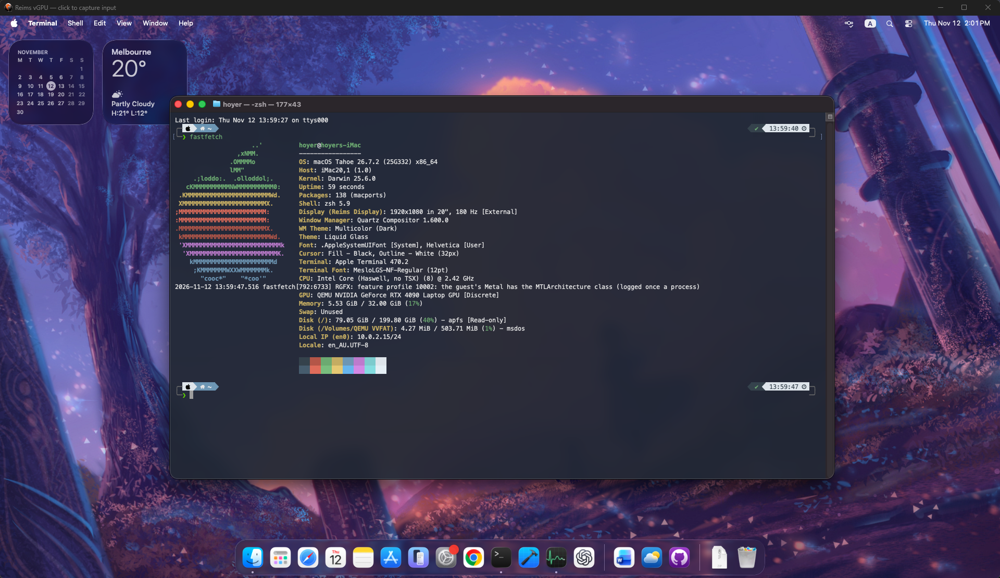

# weims-vgpu

[English](README.md) · [简体中文](README.zh-CN.md) · [日本語](README.ja.md)



## Windows 快速开始 · 1.1.0-pre.1

> **预发布版：虚拟机可能卡死，包括调整分辨率时。这是已知问题，将在后续更新中解决。请备份重要数据。** 交互软件仍在开发中。本机已验证自动准备并进入 Tahoe 恢复界面，尚未验证从全新安装到桌面的完整流程。

要求：Windows 10 2004+/11 x64、BIOS/UEFI 开启虚拟化、开启 **Windows 虚拟机监控程序平台（WHPX）** 并重启，以及支持 `VK_EXT_external_memory_host` 的 Vulkan 显卡与驱动。在“启用或关闭 Windows 功能”中启用 WHPX。软件不会自动修改 BIOS 或启用 Windows 功能。使用安装包**无需 WSL2、MSYS2、Rust 或 .NET SDK**。需要访问 GitHub、Apple 和上游下载服务器。

### 安装并创建虚拟机

1. 从[预发布页面](https://github.com/H0yeR404/weims-vgpu/releases/tag/v1.1.0-pre.1)下载 `Weims-Manager-1.1.0-pre.1-Setup-x64.exe`，或解压便携 ZIP。安装包与应用均带有 Weims 图标。Preview 与稳定版独立安装；默认英文，可在设置中切换中文。
2. 打开 **Weims Manager Preview → 创建虚拟机**，选择新目录、名称和容量（默认 **200 GiB**）。保留从 Apple 自动下载 Tahoe 恢复镜像，也可选择已有的兼容 `BaseSystem.dmg` / `.img`。不支持完整 ISO 或 ARM macOS。
3. 点击**创建**：自动准备 PowerShell、QEMU/Reims，下载并验证 Apple 恢复镜像，生成具有独立机器身份的 OpenCore，准备 OVMF、配套显卡驱动和 ROM，转换恢复镜像并创建空白磁盘。无需手动操作 WSL、编辑 EFI、复制固件或输入 SMC 密钥。已有目标目录会被拒绝；稀疏磁盘容量不代表已预留实际空间。
4. 启动虚拟机，在 OpenCore 中选择恢复项（隐藏时按**空格**）。进入**磁盘工具 → 显示所有设备**，按容量辨认并仅抹掉**新建的空白系统磁盘**，格式选择 **GUID 分区图 / APFS**。不要抹掉恢复盘或 OpenCore 盘。
5. 退出磁盘工具，选择**重新安装 macOS Tahoe**和新卷，等待下载和多次重启，按安装进度进入安装器或系统。进入桌面后正常关机，停止残留 QEMU 进程，在软件中取消挂载恢复镜像，保存后再次启动。

新建虚拟机默认开启**拖拽自适应分辨率**和自由鼠标。登录后拖动独立 Reims 窗口即可。已有虚拟机需先关机，在**显示与输入**选择自动适配客户机分辨率，关闭无边框模式并保存。启动分辨率范围 **800–4096 × 600–2160**；**2560×1440 仅在本机验证通过**。固定模式缩放完整画面，兼容模式保留旧行为。若调整失去响应，请保留日志，并尽可能正常重启。本版不含剪贴板或文件共享。

### 命令行（安装包和便携版均包含）

在应用安装或解压目录打开 Windows PowerShell。`create` 自动准备同样的组件；省略 `--recovery` 即从 Apple 下载。

```powershell
.\Weims.Cli.exe create --destination D:\VMs\macOS-Tahoe --disk-gib 200
.\Weims.Cli.exe start --config D:\VMs\macOS-Tahoe\state\config.json --display-mode auto
.\Weims.Cli.exe status --config D:\VMs\macOS-Tahoe\state\config.json
.\Weims.Cli.exe shutdown --config D:\VMs\macOS-Tahoe\state\config.json
# macOS 已关机后，退出剩余 QEMU 进程：
.\Weims.Cli.exe stop --config D:\VMs\macOS-Tahoe\state\config.json
```

已有 200 GiB 虚拟机直接将其实际 `state/config.json` 传给 `start`，不要重新创建磁盘。Preview 尚无运行环境时先执行 `setup`。GUI 与 CLI 共用 `%LOCALAPPDATA%\Weims\Manager-Preview`，不要重复启动同一磁盘。`stop` 仅允许退出 QMP 确认为已关机的虚拟机；关机请求无响应时请使用 macOS 苹果菜单。

[预发布说明](docs/prerelease-1.1.0-pre.1.zh-CN.md) · [稳定版 1.0.1](https://github.com/H0yeR404/weims-vgpu/releases/tag/v1.0.1)。稳定版不含自动引导准备或自适应分辨率。

### 方案 B：从源码构建（进阶用户）

适合需要修改 Weims、编译 Windows 图形后端或从源码复现的用户。

**步骤 1 — 安装前置工具**

- [Git for Windows](https://git-scm.com/downloads/win)
- [PowerShell 7](https://github.com/PowerShell/PowerShell/releases)
- [Rustup](https://rustup.rs/)
- [MSYS2](https://www.msys2.org/)

将 MSYS2 安装到 `C:\msys64`，或相应修改下文路径。

**步骤 2 — 配置 MSYS2**

这里使用的是 **Windows 上的 MSYS2 UCRT64，不是 WSL2**。MSYS2 虽然使用 `pacman`，但 `mingw-w64-ucrt-x86_64-*` 是 Windows 构建工具包，不是 Arch Linux 软件包。Debian/Ubuntu 的 `apt`、Arch 的 `pacman` 和 Fedora 的 `dnf` 均不能替代这一步的 Windows 原生构建环境。

从 **Windows 开始菜单 → MSYS2 UCRT64** 打开终端，或在 **Windows PowerShell** 中运行：

```powershell
& 'C:\msys64\msys2_shell.cmd' -defterm -here -no-start -ucrt64
```

在新打开的终端中执行 `echo "$MSYSTEM"`，确认输出为 `UCRT64`；否则请先打开正确的终端。下面的命令必须在 **UCRT64 终端内**执行，不要直接粘贴到 PowerShell、命令提示符、Git Bash 或 WSL 终端：

```sh
pacman -Syu
```

若提示重启终端，重启后再次运行更新。然后安装构建工具：

```sh
pacman -S --needed git make diffutils bison flex mtools \
  mingw-w64-ucrt-x86_64-{clang,llvm,llvm-tools,lld,cmake,meson,ninja,python,glib2,pixman,pkgconf,libslirp,libusb,SDL2,vulkan-headers,vulkan-loader,vulkan-validation-layers,spirv-tools}
```

**步骤 3 — 下载并构建 Weims**

返回 **Windows PowerShell 7** 执行以下命令。`scripts/build.ps1` 会按需调用 MSYS2，目标是 Windows 可执行程序，并非 Linux 构建脚本：

```powershell
git clone https://github.com/H0yeR404/weims-vgpu.git
cd weims-vgpu

$env:WEIMS_MSYS2 = "C:\msys64"

rustup toolchain install nightly-2026-11-03-x86_64-pc-windows-gnu --profile minimal

pwsh -File scripts/fetch.ps1
pwsh -File scripts/build.ps1
```

脚本会下载固定版本的 Reims、QEMU 和 metal2vulkan，校验并应用 Windows 兼容补丁，构建原生 Windows QEMU/Reims 组件。

构建输出：

```text
build/port-qemu/
build/port-dist/
```

对应的图形 ROM：

```text
sources/reims/firmware/prebuilt/ReimsGraphics.rom
```


构建软件和 CLI 前请安装 .NET 8 SDK，然后运行：

```powershell
pwsh -File manager/build-display.ps1
pwsh -File manager/build-setup.ps1
pwsh -File manager/build.ps1 -SelfContained
```

### 可选：使用 WSL2 工具检查或准备 EFI 文件

按前文 Windows 流程操作时可跳过本节。WSL2 可提供检查文件、处理 OpenCore raw FAT 镜像副本的 Linux 工具；下面的软件包**不能替代 Windows QEMU/Reims 构建环境**，也不会启用 WHPX 或安装 Windows Vulkan 驱动。

如果已有 WSL2，在 **Windows PowerShell** 中列出已安装发行版并进入其中一个。将 `Ubuntu` 替换为列表中的准确名称，例如 `Debian`、`Arch` 或实际显示的 Fedora 名称：

```powershell
wsl --list --verbose
wsl -d Ubuntu
```

确认列表中目标发行版的 WSL 版本为 `2`。进入 Linux 终端后，用 `cat /etc/os-release` 确认发行版，**仅执行与该发行版对应的一组命令**。以下假设用户具有 `sudo` 权限；若当前是 root，可省略 `sudo`。

**Debian / Ubuntu — 在 WSL2 内执行：**

```sh
sudo apt update
sudo apt install git python3 mtools
```

**Arch Linux — 在 WSL2 内执行：**

```sh
sudo pacman -Syu --needed git python mtools
```

**Fedora — 在 WSL2 内执行：**

```sh
sudo dnf install git python3 mtools
```

EFI 辅助脚本因使用 `tomllib` 而要求 **Python 3.11 或更新版本**。执行 `python3 --version` 和 `python3 -c 'import tomllib'` 检查；若不满足，使用提供 Python 3.11+ 的发行版版本，或改用前文 MSYS2 准备流程。

不同终端中的路径也不同：Windows 的 `C:\VM-inputs\OpenCore.img` 在 MSYS2 中是 `/c/VM-inputs/OpenCore.img`，在 WSL2 中是 `/mnt/c/VM-inputs/OpenCore.img`。使用 WSL2 时先进入实际仓库路径，例如 `cd /mnt/d/Coding/weims-vgpu`，将 EFI 辅助命令改为 `python3 scripts/prepare-opencore.py vm/boot-work/EFI`，不要使用 `/ucrt64/bin/python.exe ...`。此方式仅用于替代镜像副本的 EFI 准备步骤，并要求源码已获取；不要对同一副本重复执行两套准备流程。Windows `ocvalidate`、构建及虚拟机启动仍在 Windows PowerShell 中执行。输入 `exit` 退出 WSL2。

## 本机测试环境

> **兼容性备注：** 本项目目前仅在下述本机配置上完成测试并成功运行。其他设备理论上支持，但兼容性及能否正常运行仍需实际测试确认。

| 项目 | 配置 |
| --- | --- |
| 笔记本 | 联想拯救者 Legion Y9000P IRX8H（82WQ） |
| 宿主系统 | Windows 11 专业工作站版，x86_64 |
| Windows 构建 | 10.0.26300.9550（Fastfetch 标识为 26H2） |
| CPU | Intel Core i9-13900HX，32 个逻辑处理器 |
| GPU | NVIDIA GeForce RTX 4090 Laptop GPU，报告显存 15.67 GiB |
| 宿主内存 | 报告可用总量 95.81 GiB |
| 宿主显示器 | CU34G4 外接显示器，3440 × 1440，180 Hz |
| 宿主 Shell | PowerShell 7.6.9 |
| 虚拟化 / 图形 | WHPX / Vulkan，客户机内存共享图形通道 |
| 测试客户机 | macOS Tahoe，8 vCPU，32 GiB 内存，200 GiB 虚拟系统盘 |
| 客户机分辨率 | 1920 × 1080 |

以上是已测试设备，并非最低或推荐配置。宿主显示器刷新率不等于客户机渲染帧率。宿主已有的 PowerShell 版本也不同于自动准备功能在需要时下载的固定 PowerShell 7.7.0 版本。

实现通过 22 项 C API 测试；一次 10 秒拖窗测试记录 54.17 个不同画面/秒，最大帧间隔 211 ms。这不是严格同场景的新旧对照，也不代表长期稳定性或所有显卡表现。共享内存仍包含宿主 device cache 和必要复制，并非全程零拷贝。

## 上游与许可证

基于 [Reims vGPU](https://github.com/steelbrain/reims-vgpu)、[metal2vulkan](https://github.com/steelbrain/metal2vulkan)、[QEMU Reims](https://github.com/steelbrain/qemu-reims-vgpu) 以及 [tqmane 的 Windows 移植](https://github.com/tqmane/reims-vgpu)。本项目不是上游官方发行版；

Reims 和 metal2vulkan 保留 `GPL-2.0-or-later OR LGPL-3.0-or-later` 双许可证；QEMU 保留各文件原有许可证。集成脚本和文档采用 GPL-2.0-or-later。详见 [LICENSE](LICENSE)、[署名与来源](NOTICE.md) 和 [完整许可证文本](licenses/)。截图中的 Apple 软件、商标及第三方内容不由本仓库授予许可。
